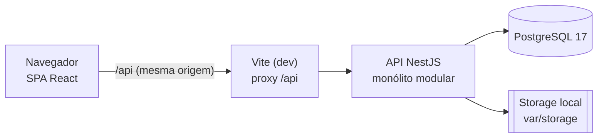

# Arquitetura — CreditFlow (Parte A)

Estado: Parte A concluída (Etapas 1–13). Sem IA, agentes ou LLMs.

## Visão geral

- **Monólito modular** ([ADR-0001](decisions/ADR-0001-monolito-modular.md)): uma API NestJS 12 (ESM) e uma SPA React 19, em monorepo pnpm.
- **Mesma origem**: em desenvolvimento o navegador só fala com o Vite, que faz proxy de `/api`; cookies first-party e CORS desligado.
- **Fonte de verdade das regras compartilhadas**: `packages/shared` (enums, matriz de permissões, máquina de estados, validadores de CPF/CNPJ, regras de cliente, indicadores descritivos). A API impõe; o frontend usa as mesmas funções para orientar o usuário.

## Repositório

| Pasta             | Conteúdo                                                                                                                                                                                     |
| ----------------- | -------------------------------------------------------------------------------------------------------------------------------------------------------------------------------------------- |
| `apps/api`        | API NestJS — `src/modules/*` (domínio), `src/common` (erros, paginação, contexto, validação), `src/infra` (Prisma, storage, senha), `prisma/` (schema, migrations, seed), `test/integration` |
| `apps/web`        | SPA — `src/app` (rotas, guards, layout), `src/features/*` (telas por domínio), `src/components` (UI), `src/lib` (cliente HTTP, formatação)                                                   |
| `packages/shared` | TypeScript puro, sem dependências                                                                                                                                                            |
| `e2e`             | Playwright: fluxo principal ponta a ponta                                                                                                                                                    |
| `docs`            | plano, arquitetura, domínio, segurança, ADRs, checklist de aceite                                                                                                                            |

## Módulos da API

| Módulo         | Responsabilidade                                                           | Principais rotas                                  |
| -------------- | -------------------------------------------------------------------------- | ------------------------------------------------- |
| `auth`         | sessões opacas, login/logout, troca de senha, `AccessGuard` (default deny) | `/auth/*`                                         |
| `users`        | administração de usuários                                                  | `/users`                                          |
| `customers`    | clientes PF/PJ                                                             | `/customers`                                      |
| `applications` | solicitações, máquina de estados, histórico, pendências                    | `/applications`, `/issues`                        |
| `documents`    | upload/download/validação de documentos                                    | `/applications/:id/documents`, `/documents`       |
| `analysis`     | indicadores descritivos, pareceres, decisão humana                         | `/applications/:id/{indicators,reviews,decision}` |
| `dashboard`    | métricas calculadas do banco                                               | `/dashboard/metrics`                              |
| `audit`        | gravação transacional e consulta da trilha                                 | `/audit-events`                                   |
| `health`       | liveness + banco                                                           | `/health`                                         |

Regra de fronteira: um módulo usa outro apenas pelo _service_ exportado (ex.: `documents` e `analysis` usam `ApplicationsService.getVisibleOrThrow`/`transition`).

## Caminho de uma requisição

1. `RequestContextMiddleware` — `X-Request-Id`, contexto (AsyncLocalStorage) usado por auditoria e logs.
2. `CsrfGuard` — header obrigatório em métodos mutáveis + checagem de `Origin`.
3. `AccessGuard` — sessão válida, senha temporária, permissão declarada na rota.
4. `ValidationPipe` — DTOs com whitelist (campos desconhecidos → 400).
5. Service — regras de negócio; mudanças de status passam todas por `ApplicationsService.transition` (máquina de estados → permissão → regras do caso → `UPDATE … WHERE status = ?` → histórico → auditoria, em uma transação; [ADR-0006](decisions/ADR-0006-maquina-de-estados.md)).
6. `ProblemDetailsFilter` — qualquer erro vira RFC 9457 com `requestId`.

## Dados

PostgreSQL com Prisma 7 e migrations versionadas. Regras críticas também no banco (CHECKs, `UNIQUE`, triggers append-only em auditoria, histórico, pareceres e decisões). Modelo em [domain-model.md](domain-model.md); integridade em [ADR-0004](decisions/ADR-0004-integridade-no-banco-e-seed.md).

## Frontend

React Router 8 (rotas carregadas sob demanda), TanStack Query (estado remoto; `GET /auth/me` é a fonte da sessão), React Hook Form + Zod (mesmos validadores do shared), Tailwind 4 e componentes no estilo shadcn no repositório. Guards e menu por permissão são apenas experiência de uso — a API recusa de qualquer forma. Detalhes em [ADR-0009](decisions/ADR-0009-frontend-base.md).

## Testes

| Camada        | Ferramenta                         | Onde                                              | O que cobre                                                                                                                                                 |
| ------------- | ---------------------------------- | ------------------------------------------------- | ----------------------------------------------------------------------------------------------------------------------------------------------------------- |
| Unitário      | Vitest                             | `packages/shared`, `apps/api/src`, `apps/web/src` | matriz de permissões, 70 combinações da máquina de estados, validadores, indicadores, storage, detecção de tipo de arquivo, telas com API simulada          |
| Integração    | Vitest + Supertest + Postgres real | `apps/api/test/integration`                       | autenticação, RBAC, CSRF, clientes, solicitações (incl. concorrência), documentos maliciosos, análise e decisão, dashboard, auditoria, constraints do banco |
| Ponta a ponta | Playwright                         | `e2e/`                                            | fluxo principal com três papéis em navegador real + permissões no backend ([ADR-0010](decisions/ADR-0010-testes-e2e.md))                                    |

## Execução local

Ver [README](../README.md). Resumo: `docker compose up -d --wait` → `pnpm install` → `pnpm db:migrate` → `pnpm db:seed` → `pnpm dev`.

## Evolução (Parte B)

Pontos de extensão já existentes, sem implementar nada de IA: a porta `DocumentStorage` (troca por S3/MinIO), o pipeline único de transições (um futuro módulo não altera status por fora), a auditoria transacional e as permissões por rota. A Parte B só começa com autorização explícita.
