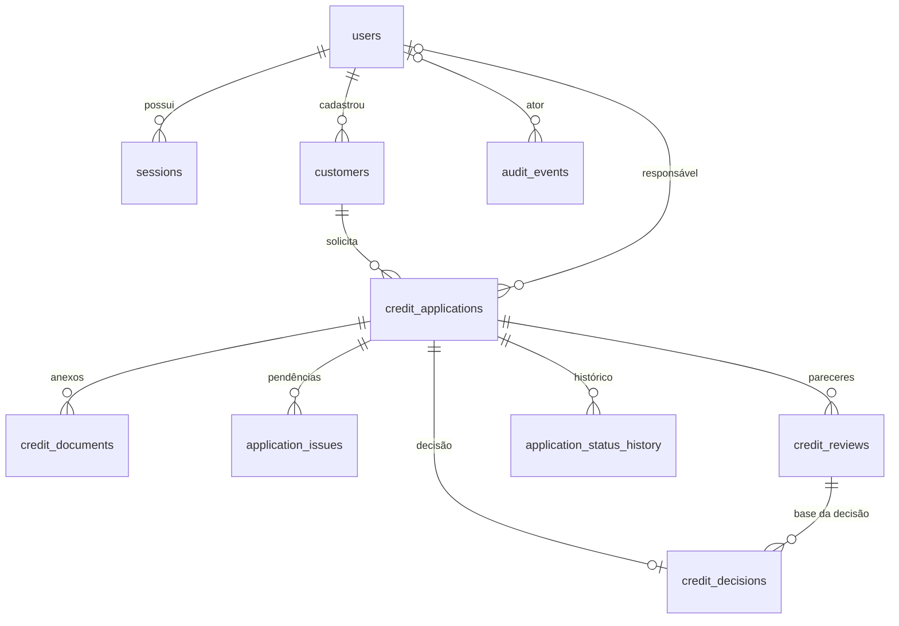

# Modelo de domínio — CreditFlow (Parte A)

Fonte da verdade: [`apps/api/prisma/schema.prisma`](../apps/api/prisma/schema.prisma) + SQL manual em [`migrations/*_init/migration.sql`](../apps/api/prisma/migrations). Enums espelhados em [`packages/shared/src/enums.ts`](../packages/shared/src/enums.ts) (teste de integração garante igualdade).

## Diagrama

## Tabelas

| Tabela                       | Papel                                       | Observações                                                                                                                                                                                |
| ---------------------------- | ------------------------------------------- | ------------------------------------------------------------------------------------------------------------------------------------------------------------------------------------------ |
| `users`                      | Usuários e papel (ADMIN, ANALYST, OPERATOR) | e-mail sempre minúsculo (CHECK); `password_hash` Argon2id; `can_decide` = concessão explícita de decisão; `must_change_password`                                                           |
| `sessions`                   | Sessões opacas                              | só `token_hash` (SHA-256) é gravado                                                                                                                                                        |
| `customers`                  | Clientes PF/PJ                              | `document_number` só dígitos, único, CPF(11)/CNPJ(14) coerente com `type` (CHECK); endereço embutido; `version` p/ optimistic locking; `anonymized_at` reservado                           |
| `credit_applications`        | Solicitações                                | `number` sequencial; código exibido `CF-AAAA-000123` é **derivado** (`formatApplicationCode`), não armazenado; valores `NUMERIC(14,2)`; renda/compromissos declarados ficam na solicitação |
| `credit_documents`           | Metadados de anexos                         | arquivo fica no storage (`storage_key` opaco); MIME detectado pelo conteúdo; `sha256`; remoção lógica (`deleted_at`)                                                                       |
| `application_issues`         | Pendências                                  | OPEN/RESOLVED; RESOLVED exige resolvedor e data (CHECK)                                                                                                                                    |
| `credit_reviews`             | Pareceres                                   | **append-only**; o mais recente é o vigente                                                                                                                                                |
| `credit_decisions`           | Decisão humana final                        | **append-only**; no máximo 1 por solicitação (UNIQUE); referencia o parecer vigente                                                                                                        |
| `application_status_history` | Linha do tempo de status                    | **append-only**                                                                                                                                                                            |
| `audit_events`               | Trilha de auditoria                         | **append-only**; `before`/`after` só com campos permitidos; nunca segredos nem conteúdo de arquivos                                                                                        |

## Integridade no banco (além do Prisma)

- **CHECK**: e-mail minúsculo; formato de CPF/CNPJ × tipo; CEP 8 dígitos; UF 2 letras maiúsculas; valor > 0; prazo 1–360; renda/compromissos ≥ 0; tamanho do arquivo > 0; SHA-256 hex; `OTHER` exige descrição; pendência resolvida exige resolvedor.
- **Triggers append-only** (`forbid_mutation`) bloqueiam `UPDATE`/`DELETE` por linha em `audit_events`, `application_status_history`, `credit_reviews`, `credit_decisions`. `TRUNCATE` não dispara triggers de linha — usado apenas pelos testes, apenas no banco de teste.
- **FKs `ON DELETE RESTRICT`** em todas as relações: a aplicação não faz hard delete.

## Regras de cliente (Etapa 4)

- CPF para PF e CNPJ para PJ, validados por dígito verificador; armazenados só com dígitos; únicos (409 com `existingCustomerId`).
- `type` e `documentNumber` são imutáveis após a criação.
- Data de nascimento (PF, mín. 18 anos) ou de constituição (PJ), nunca no futuro.
- Edição com controle de concorrência otimista: o cliente envia a `version` lida; versão desatualizada → 409 `version-conflict`.
- Auditoria de edição registra apenas os campos alterados (antes/depois), evitando cópias integrais de dados pessoais.

## Máquina de estados da solicitação (Etapa 5)

Tabela única em [`packages/shared/src/application-state-machine.ts`](../packages/shared/src/application-state-machine.ts); regras e concorrência em [ADR-0006](decisions/ADR-0006-maquina-de-estados.md).

| De                                           | Ação                | Para                        | Quem                                         |
| -------------------------------------------- | ------------------- | --------------------------- | -------------------------------------------- |
| DRAFT                                        | submit              | SUBMITTED                   | operador/admin (exige identificação + renda) |
| SUBMITTED                                    | start-review        | UNDER_REVIEW                | analista (vira responsável)                  |
| SUBMITTED, UNDER_REVIEW, PENDING_INFORMATION | assign              | UNDER_REVIEW / mesmo status | admin (analista ativo)                       |
| UNDER_REVIEW                                 | release             | SUBMITTED                   | responsável ou admin                         |
| UNDER_REVIEW                                 | request-information | PENDING_INFORMATION         | responsável (≥ 1 pendência aberta)           |
| PENDING_INFORMATION                          | resume              | UNDER_REVIEW                | operador/admin                               |
| DRAFT, SUBMITTED, PENDING_INFORMATION        | cancel              | CANCELLED                   | operador/admin (motivo)                      |
| UNDER_REVIEW                                 | cancel              | CANCELLED                   | só admin (motivo)                            |
| CANCELLED                                    | reopen              | SUBMITTED                   | só admin (motivo)                            |
| UNDER_REVIEW                                 | approve / reject    | APPROVED / REJECTED         | Etapa 7                                      |

## Exclusão, retenção e anonimização

- Sem hard delete pela aplicação. Cliente é desativado (`INACTIVE`); documento é removido logicamente enquanto a solicitação é editável.
- Auditoria e histórico são permanentes no MVP (sem expurgo automático).
- Anonimização (etapa opcional 14): substituir dados pessoais do cliente por marcadores, apagar arquivos do storage, manter agregados e auditoria; marcar `anonymized_at`.

## Dados de demonstração

`pnpm db:seed` / `pnpm db:reset` geram dados **100% sintéticos** e determinísticos (seed fixa do faker + data de referência fixa 20/11/2026):

- 5 usuários: `admin@`, `analista@`, `analista2@`, `operador@`, `operador.decisor@` (todos `@creditflow.test`; o último com `can_decide`).
- 20 clientes (14 PF, 6 PJ; 1 inativo). CPF/CNPJ aleatórios com dígito verificador válido; e-mails `@exemplo.test`; telefones `+55 11 90000-xxxx`.
- 30 solicitações cobrindo todos os status (3 DRAFT, 5 SUBMITTED, 5 UNDER_REVIEW, 4 PENDING_INFORMATION, 6 APPROVED, 4 REJECTED, 3 CANCELLED), com histórico, pendências, pareceres, decisões e auditoria coerentes com a máquina de estados.
- PDFs sintéticos mínimos ("DOCUMENTO SINTETICO — sem validade") gravados em `STORAGE_DIR`.
